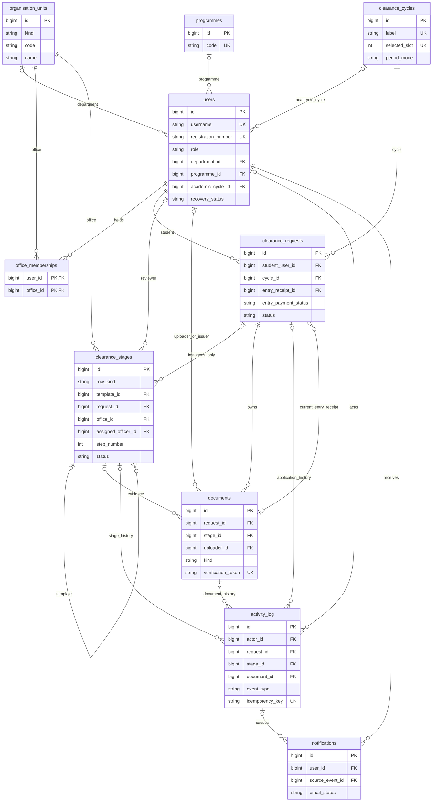
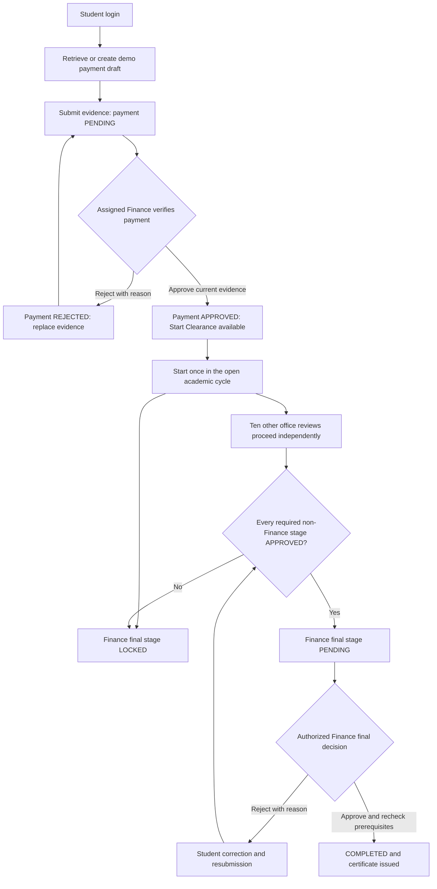

# IRDP database and Finance workflow review

Review date: 18 October 2026. Status: **PROPOSAL — NOT IMPLEMENTED**.

This report follows the supplied analysis-first instructions and the subsequent instruction: **do not add features that are absent from the current system**. No database restructuring, production-data corrections or Finance workflow changes have been performed. The previously requested interface refresh and removal of the certificate table's Action column were separate work.

## Decision in brief

The inspected database has **30 base tables, 46 foreign keys and 56 active accounts**. None of these 30 tables can simply be deleted as unused without replacing its responsibilities. Several can be consolidated around the same business entity or lifecycle.

The proposed target below has **exactly 10 base tables**, preserves multiple-office membership, both certificate verification routes, account recovery and import history, and introduces the requested payment gate and Finance-last rule. It is a substantial application refactor, not a cleanup migration. Reducing table count does not by itself improve performance.

The ten-table proposal has explicit architectural conditions:

1. Account recovery stores the current challenge/request on the account; previous recovery records become restricted, immutable security-history events. The current code already serializes recovery per account and invalidates superseded credentials.
2. Workflow templates and their clearance-specific instances share a constrained stage table. Their kinds and permitted references must be enforced, not inferred from nullable fields alone.
3. IP/email login throttling moves from SQL to durable, locked private files on this **single application host**. All six existing bucket records must be transferred. Browser sessions are not an acceptable replacement. A multiple-host deployment needs a tested shared atomic store before rollout.
4. Migration versions become immutable migration events plus a deployment manifest; no eleventh SQL metadata table or hidden compatibility tables.

These conditions need explicit review. If the institution requires a separate normalized relation for every recovery record and requires SQL-backed throttling, this exact ten-table variant is unsuitable; retain additional dedicated tables rather than disguising unrelated records in a catch-all table. No approval is assumed.

## 1. Inspection scope and evidence

Inspected the PHP routes, shared application services, installer, all migration modules, `database.sql`, scheduled jobs, test suites, older design documents and the actual local database. The database is **MariaDB 10.4.32**, with InnoDB tables and `utf8mb4_unicode_ci`. No database views or triggers were found.

Live queries used `config/database.php` directly and read-only transactions. The application bootstrap and migration runner were deliberately not invoked during database analysis: startup can run migrations if its version marker is missing.

Evidence files contain schema metadata, aggregate results and source references, not account passwords or SMTP credentials:

- [Complete current inventory: columns, primary keys, foreign keys, indexes and source references](../storage/private/database-review-20261018/SCHEMA_INVENTORY.md)
- [Exact captured schema metadata and CREATE TABLE definitions](../storage/private/database-review-20261018/current-schema.json)
- [Consistency checks and the SELECT statements used](../storage/private/database-review-20261018/consistency-checks.json)
- [Additional authority and recovery checks](../storage/private/database-review-20261018/additional-checks.json)
- [Per-table source-reference index](../storage/private/database-review-20261018/source-dependencies.json)

Counts describe inspection snapshots, not a maintenance freeze. Recheck them at migration time. The source index is a lexical index; it also includes UI text and tests, so references alone are not proof of a runtime SQL dependency. The core dependencies below were checked against the service code.

Older `TEN_TABLE_DESIGN.md`, `CORE_TEN_TABLES.md` and `DATABASE_TABLE_ANALYSIS.md` describe historical, rolled-back versions and older counts. They are not the current migration plan. In particular, the old ten-table design removed recovery and restricted officers to one office; those shortcuts are excluded here.

## 2. Current table inventory and proposed mapping

`id` is the current primary key unless a different key is stated. The appendix records the exact indexes and every declared relationship.

| Current table | Rows | Purpose / primary dependency | Proposed destination and preservation rule |
|---|---:|---|---|
| `roles` | 4 | Fixed account roles; login, permission checks | Validated `users.role`: STUDENT, OFFICER, ADMIN, SUPERVISOR; preserve role mapping |
| `users` | 56 | Credentials, identity, activation, session version; `authentication.php`, `accounts.php` | `users`; retain IDs, password hashes and account state |
| `students` | 43 | Student profile and registration; student routes, reports | Student-specific `users` columns; map old student IDs to user IDs explicitly |
| `departments` | 2 | Department catalogue and HOD restrictions | `organisation_units`, kind DEPARTMENT; retain code/name/active state |
| `programmes` | 10 | Programme catalogue; admin, imports, validation | `programmes`; independent academic catalogue retained |
| `offices` | 11 | Clearance office catalogue | `organisation_units`, kind OFFICE; preserve identity independently of departments |
| `user_offices` | 12 | Many-to-many review authority; PK `(user_id,office_id)` | `office_memberships`; no one-office-per-officer restriction |
| `workflow_steps` | 11 | Editable ordered workflow; `admin/workflow.php` | TEMPLATE rows in `clearance_stages`; preserve step IDs in mapping and all office links |
| `academic_cycles` | 2 | Academic years and availability | `clearance_cycles`; retain IDs and labels |
| `clearance_period` | 1 | Selected cycle, manual/scheduled opening, remarks | Selected cycle's period columns in `clearance_cycles`; preserve original singleton snapshot in audit history |
| `clearance_fee_rates` | 0 | Optional cycle fee override; Finance settings | `clearance_cycles.entry_fee_amount`; retain the effective default and future overrides |
| `clearance_fee_payments` | 9 | Pre-clearance entry-fee quote, reference, receipt version, verification | Entry-payment columns on `clearance_requests`; fee-only rows become payment drafts, not started clearances |
| `clearance_fee_receipts` | 4 | Versioned entry-fee file metadata | `documents`, kind ENTRY_RECEIPT; preserve every version and private file |
| `clearance_fee_actions` | 26 | Entry-payment history | Immutable `activity_log` payment events with original actor/time/payload |
| `clearance_requests` | 4 | Student application, cycle, current status | `clearance_requests`; preserve existing IDs and start/completion timestamps |
| `clearance_stages` | 44 | Current office assignment, review, liabilities and corrections | INSTANCE rows in `clearance_stages`; retain existing instance IDs |
| `review_cycles` | 46 | Submission rounds, open/close times, student responses | `activity_log` cycle history plus current cycle/version on stage; retain every original record |
| `stage_actions` | 33 | Approval, rejection, Finance-payment decisions | Immutable `activity_log` decision events; do not deduplicate against general audit entries |
| `stage_evidence` | 2 | Office correction files and Finance debt receipts | `documents`, kind STAGE_EVIDENCE or FINANCE_RECEIPT; retain stage/cycle binding |
| `certificates` | 2 | Legacy certificate numbers and verification codes | `documents`, kind LEGACY_CERTIFICATE; retain public verification codes and old routes |
| `transcripts` | 2 | Current Student Clearance Certificate snapshots, token, hash, versions | `documents`, kind CLEARANCE_CERTIFICATE; keep original JSON bytes, hashes, tokens and revocation state |
| `notifications` | 199 | Per-user inbox and read state | `notifications`; preserve IDs, messages and read state |
| `email_outbox` | 58 | One optional delivery job per notification | Nullable email-delivery columns on `notifications`; keep SENT status, attempts and retry timestamps |
| `audit_logs` | 233 | Central administrative/security/workflow history | Immutable `activity_log`; original rows retained alongside specialized history |
| `password_reset_requests` | 0 | Administrator-assisted recovery queue | Current recovery request on `users`; completed/history records in restricted security events |
| `password_resets` | 0 | Hashed single-use reset credentials | Current reset columns on `users`; historical records preserved in restricted security history |
| `student_password_otps` | 1 | Student email challenge, expiry, attempts and delivery | Current OTP columns on `users` if still current; preserve old challenge metadata/history securely |
| `rate_limits` | 6 | Atomic shared throttling; PK `bucket_hash` | Durable private rate-limit store, transferred without resetting attempts/windows |
| `import_runs` | 0 | Batch import totals and administrator | Immutable import events in `activity_log`; import UI remains supported |
| `schema_migrations` | 9 | Applied migration history; PK `version` | Unique migration events and deployment manifest; startup must use the new readiness check |

The empty tables are **not redundant**: fee overrides, recovery and imports have reachable writers/readers. `certificates` and `transcripts` overlap conceptually but hold different public identifiers and representations; merging their storage must not invalidate either.

## 3. Current relationships, consistency and structural findings

The main chain is `users → students → clearance_requests → clearance_stages → stage_actions/review_cycles/stage_evidence`. Roles and departments constrain accounts; `user_offices` supplies office authority. Workflow steps point to offices. Entry payments independently point to students and academic cycles before an application exists. Notifications have at most one SQL email delivery job. Two document systems point to completed requests.

### Verified findings

| Check | Result | Implication |
|---|---|---|
| Declared foreign-key orphans | 0 across 46 relationships | Existing declared links are consistent in this snapshot |
| Accounts | 43 students, 12 officers, 1 admin, 0 supervisors; all active | Preserve all 56 identities and hashes |
| Duplicate student/cycle applications | 0 | Existing unique constraint is effective |
| Duplicate request/workflow-step rows | 0 | Add a constraint before this can drift; currently not unique |
| Existing stage counts | 4 requests, each with 11 stages | No stage reconstruction is needed |
| Invalid current office/department reviewer authority | 0 | Preserve FMS/EPM restrictions and current assignments |
| Programme/cycle references without matching catalogue value | 0 | String references can be converted to real FKs |
| Student account/profile disagreement | 1 email difference with one side empty; no conflicting pair of nonempty emails; 0 registration, department or phone mismatches | Preserve both originals and use the account's recovery identity deliberately |
| Missing current review rounds or evidence-round links | 0 | History mappings can be built from existing relationships |
| Missing receipt pointers/version matches | 0 | Carry current receipt and payment-version binding forward |
| Uploaded evidence | All 6 referenced files exist and match stored byte sizes | File hashes and full backup/restore verification still required before migration |
| Certificate snapshots | Both stored hashes match snapshot bytes | Keep bytes unchanged when migrating |
| Completed requests | 2; no currently unapproved stage in either | Retain their existing certificates and historical completion facts |
| Active requests | 2; Finance is not LOCKED despite pending prerequisites | Existing behavior differs from the new Finance-last rule |
| Historical ordering | 1 IN_PROGRESS application has Finance approved before its prerequisites were all approved | Preserve that decision and require an audited final-review transition at cutover |
| Started clearance without approved entry fee | 0 in current records | Actual data is compliant now, but code still permits starting after upload alone |
| Payment-only records | 5 of 9 fees have no started request | These must become drafts without fabricating stages/start dates |
| Recovery conflicts | 0 duplicate live challenges, tokens or open requests | One current recovery state per account is compatible with this snapshot |
| Duplicate nonempty account emails | 0 | A normalized nullable unique account-email index is possible after preflight |
| Email delivery | All 58 existing jobs SENT | Do not resend them during migration |

### Problems and consolidation opportunities

1. **Duplicated profile attributes:** email, phone and department occur in both users and students. The observed email difference is one empty copy, not two conflicting nonempty addresses. Account email is used for login recovery; preserve both source values and select the canonical account identity explicitly. A single canonical account profile reduces drift.
2. **String catalogue links:** `students.programme`, `students.year_of_study` and `clearance_requests.academic_year` are not enforced FKs. Preserve original values while mapping to programme/cycle IDs.
3. **Missing constraints:** no unique `(clearance_request_id,workflow_step_id)` on stages; no FK for `original_officer_id`, `password_resets.issued_by` or the current fee receipt pointer; evidence round numbers are not FK-bound to review cycles. Application checks currently compensate for some of these gaps.
4. **Workflow changes can reinterpret history:** stages store `office_id`, but code also reads mutable workflow definitions to determine the office/stage behavior. Store instance-specific office, title, step and rule-version snapshots; later template edits apply only to future applications.
5. **Finance identified by step 11:** this is application convention, not a database invariant. Department FMS and the Finance review office are different entities. Being the HOD of FMS does not grant Finance payment authority.
6. **Control-number uniqueness:** automatic entry references have a unique index; manually entered `control_number` is checked by a query rather than a unique index. A shared issued-reference registry is needed if references must be unique across entry fees and Finance debt requests.
7. **Current-state/history separation:** stage details and JSON action history serve different purposes, as do review-cycle history and general audit records. Consolidate storage only while preserving each original event and provenance; matching-looking rows must not be discarded.
8. **Audit protection:** current audit fields provide actor/action/request/time/details, but before/after status is not standardized. The configured database account has broad privileges, including UPDATE, DELETE and DDL; no audit-protection triggers were found. The future runtime account needs append-only audit privileges and no schema-changing privileges.
9. **Destructive legacy migrations:** `migrations.php` contains DROP operations for retired features. An old installer started against the new schema could attempt to recreate or remove tables. Replace and test all startup/setup/migration paths before switching databases.
10. **Performance:** appropriate queue indexes exist, but audit history lacks a direct action/time index and stages lack the proposed application/step uniqueness. Optimize measured queries with EXPLAIN on a copy; do not equate fewer tables with faster queries.

No live row correction was performed. The one email discrepancy and legacy Finance ordering are migration review items, not grounds to discard accounts or documents.

## 4. Features excluded by your latest instruction

Backup delegation, officer-availability routing, emergency clearance, time-based escalation and appeals are absent from the current operational system. Their former tables are not among the 30 inspected tables. `admin/continuity.php`, `admin/emergency.php` and `supervisor/dashboard.php` redirect; `jobs/clearance_deadlines.php` reports that automatic deadlines were removed.

**Do not recreate these features or their tables.** Retain any existing assignment-source/urgent/legacy-state values and historical audit records as facts. Keep ordinary assigned-office review and the supported SUPERVISOR account role, which currently uses officer permissions. The legacy schema's enum labels alone do not constitute a working escalation feature.

## 5. Proposed ten-table schema

This is a logical schema for review, not executable migration SQL. Use InnoDB, consistent integer FK types and named constraints. Existing business IDs are retained where possible; collisions caused by mergers require a verified old-to-new map. Dates remain in the system's established EAT business-time convention unless a separate timezone migration is approved.

### 1 — `users`

- PK `id`; UNIQUE `username`; nullable UNIQUE `registration_number`; nullable UNIQUE normalized account email; role constrained to the four supported values.
- Identity, original password hash, active flag, auth version, force-change flag, email verification, creation time.
- Student fields: programme FK → `programmes.id`, department FK → DEPARTMENT unit, academic-cycle FK → `clearance_cycles.id`, DOB and private profile reference. Retain original username/registration formatting.
- Current bounded security state: recovery generation/opaque request identifier, request status, requested/handled/completed times, handler FK → users, identity reference/rejection reason; current reset-token hash/expiry/used time; current OTP challenge hash/code hash, email-at-issue, auth version, attempts, expiry/delivery/used times.
- UNIQUE nullable token/challenge hashes; indexes on role/active, department, normalized email and recovery queue status/time. Lock the user before issuing/consuming credentials and before changing recovery generation.
- Separate OTP and reset state must coexist during the transition from verified OTP to a reset credential. Do not collapse them into one ambiguous token. Only hashed credentials are stored. Preserve older security rows in restricted, encrypted migration-history payloads; never expose OTPs/reset secrets in the normal audit UI or notifications.
- CHECK student-role shape, required registration/profile fields, and bounded attempt counts. Validate active role/department authority in the transaction as today.

### 2 — `organisation_units`

- PK `id`; `kind` is DEPARTMENT or OFFICE; code, name, description, active flag, creation metadata.
- UNIQUE `(kind,code)` when code exists and `(kind,name)`; UNIQUE `(id,kind)` supports typed composite references.
- Departments and review offices are organizational units, not interchangeable roles. FMS stays a department and Finance and Accounting stays an office. Programmes do not go in this table.
- FK consumers carry a checked discriminator, e.g. `(department_id,department_kind)` → `(id,kind)` with `department_kind='DEPARTMENT'`; office references similarly require OFFICE. Use physical discriminator columns, not engine-dependent generated-column FK behavior.

### 3 — `programmes`

- PK `id`; UNIQUE `code`; name and active flag.
- Preserve all ten programme records and existing admin/import validation. Do not infer or add a new programme-to-department rule from ICT names; account department mappings remain explicit.

### 4 — `office_memberships`

- PK `(user_id,office_id)`; FKs → users and OFFICE units; office-first index for routing.
- Preserve all memberships and multi-office support. Departmental review additionally requires the officer's department to match the student's application snapshot.
- Active officer/supervisor role and active office checks remain mandatory; membership alone is insufficient.

### 5 — `clearance_cycles`

- PK `id`; UNIQUE `label`; active flag, default entry-fee amount, rate updater FK/time.
- Period mode, opens/closes timestamps, remarks, updater FK/time; nullable `selected_slot`, UNIQUE with CHECK NULL or 1, permits at most one selected cycle.
- Scheduled mode requires both dates and closing > opening. Unselected cycles retain their saved period history in audit events. A previously unconfigured global period is represented by no selected cycle, retaining its original metadata as a migration event.
- Workflow/rate changes must not alter the quoted amount or stage snapshots of an existing application.

### 6 — `clearance_requests`

- PK `id`; FKs student user → users, cycle → clearance_cycles; UNIQUE `(student_user_id,cycle_id)`.
- Application state: PAYMENT_PENDING, READY_TO_START, IN_PROGRESS, PAUSED, COMPLETED and preserved legacy terminal states; policy version, row version, start/completion times, student department/programme snapshots.
- Entry-payment state separately: PENDING, APPROVED, REJECTED; phase distinguishing awaiting evidence from awaiting verification; quoted amount, assigned Finance officer FK, reference, generated timestamp, payment version, current receipt document FK, approver FK/time, rejection reason.
- Payment-only source rows become PAYMENT_PENDING drafts. A draft is not a started clearance, is excluded from active-clearance counts and has no office-stage instances.
- Add indexes `(status,id)` and `(entry_assigned_officer_id,entry_payment_status,id)`; UNIQUE issued reference ownership is supplied by the reference registry described under activity_log.
- Preserve the current **one started clearance per registration** policy as well as the student/cycle uniqueness rule. A nullable unique `started_student_id` set to the student ID on start can enforce it. Merely adding `(student,cycle)` must not silently allow annual repeat clearances. Any change to that policy needs separate approval.

### 7 — `clearance_stages`

- PK `id`; row kind TEMPLATE or INSTANCE. This is a stage definition/realization model, not a generic record store.
- TEMPLATE: request FK NULL, unique template slot 1–11, office FK, title, active flag, requirements version. Preserve configurable mappings, including multiple stages referencing the same office if configuration allows it.
- INSTANCE: non-null request FK, template self-FK constrained to TEMPLATE kind, immutable step/office/title/requirements snapshot, assigned/original reviewer FKs, assignment metadata, status, row version, current review cycle, comments, corrective instructions, actionable/start/review times and existing liability details.
- UNIQUE `(request_id,step_number)` for instances; UNIQUE template slot for templates; CHECK kind-specific nullability. Compound FK `(template_id,template_kind)` → `(id,row_kind)` and CHECK template_kind prevents references to another instance.
- Existing Finance additional-debt fields remain separate from the entry payment: current debt reference, receipt FK/version, payment status, verification and rejection information. No new ability to charge at Dispensary/HOD is introduced.
- Index `(assigned_officer_id,status,request_id)` and `(request_id,status,step_number)`; current receipt and cycle-origin links must be validated for the same application/stage and version.
- All instance creation validates the exact configured required set. Finance is the explicit final step; position 11 alone must not override wrong office authority.

### 8 — `activity_log`

- PK `id`; immutable event type, actor FK, subject-user FK, request FK, stage FK, document FK where applicable; time, previous/new status, reason, review cycle/payment version, correlation ID and idempotency key.
- Versioned event payload retains liability details, student responses, before/after snapshots and imported original rows. Defined event contracts replace ad hoc free-form JSON; core relationships stay in FK columns.
- UNIQUE `(source_table,source_key,source_component)` on imported provenance; UNIQUE idempotency key for new commands/events. Keep audit, payment and stage-action source rows separately even where they describe one action.
- Index `(request_id,created_at,id)`, `(stage_id,review_cycle,id)`, `(actor_id,created_at)` and `(event_type,created_at)`.
- Control-issued events carry nullable UNIQUE `issued_control_number` plus the owning request/stage. Both entry and additional-debt reference issuance reserve the number here inside the same transaction; repeated use by the same payment reads the original issuance. This preserves historical references and prevents cross-payment reuse.
- Review-cycle open/close/submission events preserve all cycles; the active stage is a current-state projection, not the only history record. New events never overwrite previous decisions.
- Migration and import events are administrative actions with explicit schemas, not arbitrary settings. Authentication history is separately classified, encrypted where it contains imported credential hashes, and excluded from ordinary log access.

### 9 — `documents`

- PK `id`; kind ENTRY_RECEIPT, FINANCE_RECEIPT, STAGE_EVIDENCE, LEGACY_CERTIFICATE or CLEARANCE_CERTIFICATE; request FK, optional stage FK, uploader/issuer/revoker FKs, version/cycle and creation timestamps.
- Private files retain stored/original names, MIME, byte size and a computed checksum; UNIQUE stored name when present. Preserve file ownership and authorization checks.
- Issued certificates retain number, original verification token/code, snapshot bytes/hash, validity/revocation state, reason and source kind. UNIQUE public identifiers; version uniqueness scoped to student and document kind, and a separate legacy-certificate-per-request constraint.
- CHECK document shape: receipt requires payment binding; stage evidence requires a stage and cycle; snapshot certificate requires immutable snapshot/hash. Enforce matching application/stage via composite references and transactional validation.
- Keep both `/certificates/verify.php` and `/transcripts/verify.php` lookup semantics. No certificate is regenerated merely to fit the new schema.

### 10 — `notifications`

- PK `id`; recipient FK → users; title, message, read state, creation time and optional source-event FK.
- Optional email delivery fields: original recipient, queue state, attempts, availability/last-attempt/sent times and bounded error text.
- Index `(user_id,is_read,id)` and `(email_status,available_at,id)`; event/recipient deduplication when an event creates one notification per user.
- Preserve the current one-outbox-job-per-notification behavior and English email rendering. OTP delivery remains direct and is not stored in ordinary notification bodies.

### Relationship diagram

The diagram summarizes core links. Nullable links, composite kind/ownership constraints, self-referencing security-handler FKs and indexes are specified above. FK checks cannot enforce every cross-row business rule; transactional services must enforce authorization and workflow prerequisites.

## 6. Finance payment and final-review workflow

### Current behavior that must change after approval

- `clearance_fee_ready()` accepts AWAITING_REVIEW as well as APPROVED. `student/start.php` calls this through `require_clearance_fee_receipt()`. Upload alone therefore opens Start Clearance.
- `process_clearance_fee()` supports CONTROL, RECEIPT and APPROVE, with **no rejection action**.
- `student/start.php` makes all 11 stages PENDING. `lock_review_stage()` checks ownership/status/authority but does not require other offices to be approved before Finance acts.
- `process_stage_decision()` explicitly rejects Finance REJECTED commands. Any last office can currently cause completion when all 11 checks pass.
- `resubmit_stage()` treats Finance corrections as receipt submissions only. A final Finance rejection without a payment request needs the general explanation/evidence correction path, not a forced payment upload.

### Proposed sequence

Payment approval never equals final clearance approval. Keep separate Finance queues labelled **Entry Payment Verification** and **Final Clearance Review**. A LOCKED final stage shows the blocking offices but offers no decision action. UI labels and notification templates remain English.

The existing login preparation respects an open clearance period and does not recharge already-started students. Retain that behavior unless separately changed. No GePG integration is proposed.

### Transaction and authorization contract

1. **Reference preparation/upload:** lock the student account, selected cycle where needed, and application/payment row in a documented consistent order. Reuse the unique student/cycle draft. Preserve quote/reference timestamp on repeat login. Reject a stale reference/payment version and another student's evidence. Upload replacement sets PENDING and clears prior approval, preserving older receipts/events.
2. **Payment decision:** only the assigned active officer with Finance-office membership can approve/reject. Lock current state and check row version, current document ownership, reference, payment version and file existence. Require explicit verified-payment confirmation for approval and a nonempty reason for rejection. Write decision, audit and notification records atomically. A replay is rejected or returns an already-recorded idempotent result, without another event or notification.
3. **Start:** lock student, period/cycle and application; require payment APPROVED for the current receipt/version, correct cycle, open period and no prior started clearance. Create the exact required stage-instance set once: ten PENDING plus Finance LOCKED, with Finance `actionable_at` NULL. Duplicate start cannot create duplicate stages.
4. **Other office decision:** lock request before stage, as current code already does. Validate active membership, assigned reviewer, departmental scope, current review cycle/version and current status. A Finance-only officer cannot approve another office. Preserve approved/unaffected offices during another office's correction.
5. **Unlock:** in the transaction that completes a prerequisite, compare against the full snapshotted required stage set; do not merely test that zero non-approved rows exist, which would pass a missing-stage application. Require all ten distinct prerequisite steps approved and entry payment still approved. Atomically move Finance LOCKED → PENDING, set its actionable time and append one unlock event/notification.
6. **Finance final decision:** lock request and all prerequisite rows consistently, then recheck the exact set, assigned Finance authority, current receipt/payment state, liabilities, current cycle/version and absence of rejection. Never trust an earlier button state. Financial no-other-debt approval remains supported only when no unresolved payment demand exists.
7. **Final rejection/correction:** require reason and corrective instructions, mark Finance REJECTED and application PAUSED, retain prior approvals. A reason-only correction uses explanation/evidence; a payment correction uses the matching current receipt. Resubmission creates a new review cycle; Finance becomes PENDING only if all prerequisites still hold, otherwise LOCKED. Existing Finance additional-debt requests remain supported during eligible final review.
8. **Completion:** only the successful Finance final approval transaction can complete a new-policy application. Recheck all 11 approvals and document eligibility, record completion and generate the idempotent certificate records in that transaction. Roll back the whole decision if required certificate/audit creation fails.
9. **Concurrency:** use one published lock order across Start, payment updates, review, correction and any permitted reassignment; request-first for existing stage decisions, and deterministic ordering of sibling stages. Retry recognized deadlocks safely with idempotency keys. Do not add an office-approval reopening feature merely for this refactor; if a future authorized operation invalidates a prerequisite, it must also re-lock Finance transactionally.

### Existing records at cutover

- Keep both completed requests and all certificate identifiers/snapshots intact. Never backdate Finance approval or claim it happened last when it did not.
- Assign an explicit legacy policy version to existing completions. Apply the new sequence to newly started applications.
- For the two in-progress applications, migration must compute prerequisites and propose Finance lock/revalidation transitions as explicit audited changes. One currently already has Finance approved while prerequisites are incomplete: preserve that decision event and require a new final-review cycle under the new policy rather than deleting it. Recheck this state at cutover; the other application's Finance stage also needs its prerequisite lock applied.
- All four currently started applications have approved entry payments. Recheck this at cutover; if new noncompliant active records appear, obtain a transition decision instead of silently approving payments or cancelling clearance.
- Migrate all five fee-only records as drafts. Keep control numbers, quote times and existing payment state; do not generate new numbers simply because IDs changed.

## 7. Audit protection and retention

Use a centralized append-only ledger with typed links, actor, before/after states, reasons and timestamps. Preserve imported IDs through provenance fields, not by silently overwriting conflicting event IDs. New activity, state transitions and notification creation commit together.

The normal runtime database user receives SELECT/INSERT on the ledger and no UPDATE/DELETE/DDL there. Use a separate migration/maintenance principal; preserve historical principals through soft deactivation and RESTRICT historical FK deletes. Append correction events rather than rewriting existing entries. Optional hash chaining plus signed off-host archive manifests can detect tampering but do not make a database administrator powerless.

No audit-delete button is proposed. Retention duration and archive destination must come from institutional policy; neither is established in the inspected project. Until specified, preserve all records. An approved maintenance-only archive process must export encrypted chunks, checksums, counts, time boundaries and a searchable manifest, verify restore, record archival events and never destroy the only copy. Authentication secret material must have stricter access than ordinary workflow history.

## 8. Safe migration and rollback plan

1. **Approve the design and transition rules first.** Do not run old cleanup scripts or attempt an in-place drop-and-rebuild.
2. **Create and verify backups:** database dump including schema/constraints/routines/triggers/events as applicable; private evidence/profile/import files; configuration stored securely; original application code. Record file hashes, row counts, source schema version and a manifest. Restore into an isolated environment and verify before continuing. No restorable production backup was created by this analysis; schema evidence is not a data backup.
3. **Build against a separate database:** exactly ten target tables, no compatibility base tables/views that conceal extra storage. Install cross-reference constraints in dependency order; nullable current-document pointers can be filled after documents are loaded. Validate MariaDB 10.4 syntax on the isolated target.
4. **Stage a complete mapping:** users keep IDs; students map via their existing user_id. Allocate new organization IDs for department/office collisions. Keep request/stage instance IDs where possible; allocate new IDs above the maximum for fee-only drafts/templates. Record mappings in a protected manifest, not an eleventh live table.
5. **Import reference/identity data first:** roles as validated values, units, programmes, cycles, users and memberships. Resolve the one email discrepancy by preserving both originals and explicitly selecting the recovery/account value; no automatic account reset or credential rehash.
6. **Import applications and payments:** join by mapped student + academic cycle, not matching numeric IDs from unrelated source tables. The inspection predicts nine target applications: four started requests and five payment drafts. Preserve actual states and quotes. Do not overwrite original creation times; store both payment-requested and clearance-created timestamps.
7. **Import workflow/history/documents:** 11 templates plus 44 instances are expected before new activity. Preserve 46 review-cycle rows, 33 stage actions, 26 fee actions and 233 audit entries with provenance; event count may increase when lifecycle rows are split into events. Do not deduplicate them. Preserve all six evidence/receipt files and four issued-document records. Retain old file/download IDs using typed legacy-ID maps so existing URLs cannot point at another document.
8. **Import notifications and security:** preserve 199 inbox rows and all 58 SENT email deliveries. Migrate current recovery state without resetting expiry/attempts or enabling used tokens; preserve original recovery history securely. Transfer rate-limit windows atomically; namespace the store by deployment/database. Import all nine migration markers into the new journal. Source counts must be refreshed before sign-off.
9. **Refactor every dependent route/service/job/test:** authentication, recovery, accounts/imports, configuration, reviews, uploads/downloads, certificates, reports, notifications, installer and scheduler. Existing paths and English labels remain compatible. Disable SMTP in rehearsal and use a local capture server so imported jobs cannot email real users.
10. **Validate and reconcile:** all entity counts, relationships, old/new IDs, history payloads, password hashes, file hashes, public verification identifiers, report totals, row ownership and policy states. An unresolved exception stops cutover; it does not justify dropping a row.
11. **Cut over during a controlled write freeze:** stop web writes and background senders, take final consistent backups, repeat import/validation, deploy matching code/config together, verify selected routes, then resume workers. No source table is deleted as part of cutover. Preserve the original database offline/read-only as the rollback copy; it is not part of the ten-table live schema.
12. **Rollback:** before target writes resume, switch code/config to the preserved source after verification. After new target writes occur, rollback requires a tested reverse transformation/replay of those writes, reconciliation and a new freeze; simply restoring yesterday's dump would lose data. Define the rollback window and data-loss target before deployment.

Do not rely on `ROLLBACK` to undo schema changes: MariaDB DDL statements can implicitly commit. Use a separate target plus verified restore/switchback instead. [MariaDB implicit-commit documentation](https://mariadb.com/docs/server/reference/sql-statements/transactions/sql-statements-that-cause-an-implicit-commit).

The proposed constraints must be executed and tested on the actual supported MariaDB version; declarations alone are insufficient evidence of enforcement. [MariaDB constraint reference](https://github.com/mariadb-corporation/mariadb-docs/blob/main/server/reference/sql-statements/data-definition/constraint.md).

## 9. Risk assessment

| Risk | Impact | Required control |
|---|---|---|
| Broad query refactor | Login, queues or reports can silently omit rows | Per-route dependency review, repositories/services updated together, full regression suite |
| Account/student or department/office ID collisions | Wrong ownership or HOD/Finance authority | Typed mappings, composite kind constraints and negative authorization tests |
| Ten-table consolidations | More nullable columns and event-replay complexity | Explicit row-kind contracts, normalized FK columns and no arbitrary settings bucket |
| Template/instance storage | Draft/template rows could appear in student queues | Mandatory kind filters; constraints and tests for missing/duplicate stages |
| Draft payments in application table | Dashboard/report counts can inflate | Explicit started-state filters and reconciliation of old totals |
| Recovery consolidation | Token replay, stale-browser grants, history loss | User locks, generation IDs, hashed credentials, expiry/attempt preservation, private history |
| File-backed throttle | Lost counters or bypass on multiple hosts | Durable shared-per-host locks, atomic writes, namespace and failure-closed behavior; no multi-host rollout without a shared store |
| Legacy completed documents | Broken QR codes or changed historical facts | Preserve both token systems and snapshot bytes; no regeneration/reordering of history |
| New Finance gate | Existing application may stop progressing | Explicit legacy/new policy distinction, audited transition report for active cases |
| Finance-only corrections | Incorrectly forcing payment for a non-payment rejection | Separate correction explanation from receipt verification; test both |
| Evidence/outbox migration | Missing files or duplicate real emails | Checksummed private storage, ownership checks, preserve SENT, SMTP capture in rehearsal |
| Audit privileges | Runtime principal can tamper with history | Separate runtime/migration accounts, append-only grants, archive/restore verification |
| Old installer and jobs | Recreates 30-table schema or runs old deletes | New readiness/version path and tests covering web startup, setup and every scheduled job |
| Concurrent live writes | Counts/mappings become stale | Final write freeze; repeat inventory and integrity checks at cutover |

## 10. Testing and acceptance plan

These are proposed implementation tests. The analysis did not implement or execute a new Finance workflow or a ten-table migration.

| Area | Required scenarios / acceptance condition |
|---|---|
| Payment approval/rejection | PENDING after evidence; only assigned Finance can decide; rejection reason required; current receipt approved; stale versions/replayed POSTs rejected |
| Payment gate | Direct Start POST, alternate routes and API/helper calls cannot create stages before approved current payment; upload alone remains locked |
| Stable controls | Repeated login retains reference, generated day/date/time and quote; concurrent preparation produces one draft/reference; duplicate control across debt/entry payments rejected |
| Finance lock | Any missing, duplicate, pending, rejected or incomplete prerequisite keeps Finance LOCKED; direct malicious POST also rejected |
| Finance unlock | Exactly the required ten distinct approvals unlock once; no unlock from zero-row/missing-stage edge cases |
| Final approval | Assigned active Finance only; no approval of other offices; all prerequisites rechecked under locks; completion/certificate issued once |
| Correction flows | Non-Finance rejection/explanation/files; Finance final rejection with and without a payment demand; replacement receipt and new review cycles; other office approvals preserved |
| Concurrency | Double Start, double approve, stale review cycle, simultaneous final prerequisite approval, receipt replacement racing approval, unauthorized assignment change and deadlock retry |
| Academic cycle | One application per student/cycle; current once-per-registration start restriction preserved; closed/scheduled periods and effective timezone boundaries |
| Permissions | Student cannot read another student's receipt; unassigned officer blocked; FMS HOD cannot act as Finance; departmental scope enforced; inactive actors blocked |
| Audit | Each successful change has actor/time/subject/before-after/reason; rollback leaves no successful event; runtime UPDATE/DELETE/DDL against ledger denied |
| Documents | Existing verification codes/tokens, PDF contents, snapshot hashes, old URLs and revocations remain valid; zero missing referenced files |
| Account security | All 56 original hashes unchanged; student registration login, OTP expiration/resend/attempts, admin recovery queue, auth-version invalidation, idle/absolute expiry and shared throttling |
| Notifications | In-app read/unread state, English event summaries, one delivery job per notification, retry handling, preserved SENT records and no live SMTP during tests |
| Administrative features | Users, programmes, departments, offices, memberships, workflow editor, imports, reports, fee rates and clearance-period modes remain usable |
| Migration integrity | Exactly ten base tables after fresh setup and upgrade; complete provenance for all 30 sources; no foreign-key orphans, duplicate applications/stages or lost history; restore and reverse migration rehearsed |
| UI regression | Admin/student/officer/Finance screens, mobile navigation, keyboard access, 200% text, high contrast, uploads, validation and existing certificate downloads |

Existing test entry points to update/reuse include `automatic_entry_fee_test.php`, `parallel_clearance_test.php`, `finance_payment_migration_test.php`, `clearance_once_test.php`, `features_test.php`, `student_password_otp_test.php`, `email_notifications_test.php`, `session_security_test.php` and `responsive_test.php`. Several currently assert upload-unlocks-start and all-office parallelism; they must intentionally change to the approved rules rather than being removed to make a suite pass.

For the separately requested interface changes, PHP syntax checks passed and the existing browser suite passed **829 layouts and 152 keyboard-scrollable-table checks**, including existing account/navigation workflows. These results are a UI baseline, not evidence that the proposed database/Finance changes work.

## Review checkpoint

The review package is complete. **Implementation is paused for explicit approval**, as requested in the supplied prompt. Approval should cover the ten-table consolidations and durable throttle store, preservation of the current once-per-registration start rule, and the audited transition policy for in-progress Finance stages. Absent delegation/emergency/escalation features remain excluded.
