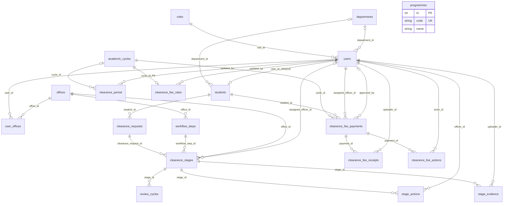
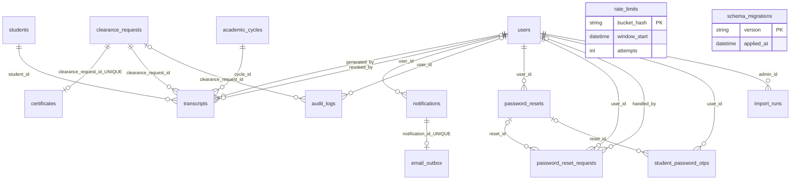

# Ukaguzi wa normalization na relationships

> Hii ni hali ya kabla ya consolidation. Hatua ya kwanza sasa imekamilika: `certificates` imeunganishwa ndani ya `transcripts`, na database ina tables **29**. Angalia [utekelezaji na migration](UNIFIED_DOCUMENTS.md). Takwimu za tables 30 hapa chini zimeachwa kama historia ya ukaguzi.

Tarehe: 2026-10-19. Chanzo: schema halisi ya database inayotumiwa na `config/database.php`, si `database.sql` pekee. Ukaguzi umetumia SELECT na SHOW; hakuna database migration au mabadiliko ya data yaliyofanywa.

## Matokeo

- Tables: **30**, zote zina primary key.
- Foreign keys: **46**, kila moja ikiwa ya column moja kwenye schema iliyokaguliwa.
- Orphan records kwenye foreign keys zilizotangazwa: **0**.
- Programme zisizopatikana kwenye `programmes.code`: **0**.
- Miaka ya clearance isiyopatikana kwenye `academic_cycles.label`: **0**.
- Email zinazotofautiana kati ya mwanafunzi na account yake: **1**. Phone na department zinazotofautiana: **0**.
- Makundi ya stages yanayorudia `(clearance_request_id, workflow_step_id)`: **0**.
- Stage office zinazotofautiana na workflow office: **0**.
- Original officers na password issuers wasio na user record: **0**.
- Payment receipt pointers zilizopotea au zinazorejea payment nyingine: **0**.
- Actions/evidence zisizo na review cycle inayolingana: **0**.
- Transcript student/year zisizolingana na request: **0**.

Haya ni matokeo ya wakati wa ukaguzi, si uthibitisho kwamba schema inazuia kila inconsistency ya baadaye. Endesha `C:\xampp\php\php.exe jobs/database_audit.php` kupata hali ya sasa bila kuonyesha majina, emails, passwords au token values.

## Inventory ya tables zote 30

`id` ni primary key isipokuwa pale ambapo key nyingine imeandikwa. References kwenye jedwali hili ni foreign keys zilizopo; mapendekezo ya references mpya yapo sehemu inayofuata.

| Table | Primary key | References zilizopo / jukumu |
|---|---|---|
| roles | id | Aina za majukumu ya account |
| departments | id | Idara za taasisi |
| users | id | role_id → roles; department_id → departments |
| students | id | user_id → users, UNIQUE; department_id → departments |
| programmes | id | Catalogue ya programme; code ni UNIQUE |
| offices | id | Ofisi za clearance |
| user_offices | user_id + office_id | users ↔ offices; many-to-many |
| workflow_steps | id | office_id → offices; step_number ni UNIQUE |
| academic_cycles | id | Miaka ya masomo; label ni UNIQUE |
| clearance_period | id | cycle_id → academic_cycles; updated_by → users; current configuration |
| clearance_requests | id | student_id → students; UNIQUE(student_id, academic_year) |
| clearance_stages | id | request → clearance_requests; workflow_step → workflow_steps; office → offices; assigned_officer → users |
| review_cycles | id | stage_id → clearance_stages; UNIQUE(stage_id, cycle_number) |
| stage_actions | id | stage_id → clearance_stages; officer_id → users; historia ya maamuzi |
| stage_evidence | id | stage_id → clearance_stages; uploader_id → users |
| clearance_fee_rates | cycle_id | cycle_id → academic_cycles; updated_by → users; bei ya sasa kwa mwaka |
| clearance_fee_payments | id | student → students; cycle → academic_cycles; assigned_officer na approved_by → users |
| clearance_fee_receipts | id | payment_id → clearance_fee_payments; uploader_id → users |
| clearance_fee_actions | id | payment_id → clearance_fee_payments; actor_id → users |
| certificates | id | clearance_request_id → clearance_requests, UNIQUE; certificate identity ya request |
| transcripts | id | student → students; request → clearance_requests; cycle → academic_cycles; generated_by/revoked_by → users; document versions |
| notifications | id | user_id → users; ujumbe wa ndani ya mfumo |
| email_outbox | id | notification_id → notifications, UNIQUE; queue na delivery state ya email |
| audit_logs | id | user_id → users; clearance_request_id → clearance_requests; matukio ya mfumo |
| password_resets | id | user_id → users; reset credentials zinazokwisha muda |
| password_reset_requests | id | user_id/handled_by → users; reset_id → password_resets; approval ya recovery |
| student_password_otps | id | user_id → users; reset_id → password_resets; OTP challenges |
| import_runs | id | admin_id → users; matokeo ya imports |
| rate_limits | bucket_hash | Counters za kuzuia majaribio mengi; si lazima ziwe user records |
| schema_migrations | version | Historia ya schema upgrades |

## Marekebisho yanayopendekezwa

### 1. Programme na academic year zitumie foreign keys

- Ongeza `students.programme_id → programmes.id`, backfill kwa `students.programme = programmes.code`, kisha badilisha forms, imports, filters na reports kutumia JOIN.
- Ongeza `clearance_requests.cycle_id → academic_cycles.id`, backfill kwa `academic_year = label`, na hatimaye UNIQUE(student_id, cycle_id).
- Programme na academic year codes zibaki kwenye catalogue tables. Usibadilishe `year_of_study` bila kwanza kufafanua kama ni kiwango cha masomo au mwaka wa kalenda; hilo ni jambo tofauti.
- Columns za zamani ziondolewe baada ya readers/writers zote kuhamishwa na validation kupita. Hizi hatua hazihitaji table mpya.

### 2. Ondoa sources nyingi za taarifa za contact

`users` na `students` zote zina email na phone. `includes/accounts.php` tayari inaandika phone kwenye tables zote mbili: hili ni jukumu la ziada la kuhakikisha copies zinafanana.

Pendekezo: email/phone ya account iwe kwenye `users`; `students` ihifadhi taarifa maalumu za mwanafunzi. Email moja inayotofautiana isichaguliwe kiotomatiki kuwa sahihi: hakiki matumizi ya email kwenye OTP, account verification na notifications kabla ya kuhamisha thamani. Ikiwa email ya mwanafunzi na login email zina maana tofauti, zipewe majina na matumizi yanayotofautisha wazi.

`department_id` ipo kwenye tables zote mbili. Department ya staff na department ya mwanafunzi inaweza kuwa na maana tofauti. Usiondoe column kwa sababu thamani zake zinafanana sasa pekee; fafanua ownership yake kwenye authorization na student records kwanza.

### 3. Imarisha constraints ambazo bado hazipo

| Reference/constraint | Pendekezo |
|---|---|
| clearance_stages.original_officer_id | FK → users.id; amua retention/delete policy ya historia |
| password_resets.issued_by | FK → users.id; preserve issuer history au SET NULL kwa sera iliyo wazi |
| clearance_fee_payments.receipt_id | FK → clearance_fee_receipts.id na enforcement kwamba receipt inamilikiwa na payment hiyo; FK ya id pekee haitoshi kuthibitisha ownership |
| stage_actions(stage_id, review_cycle) | Composite FK → review_cycles(stage_id, cycle_number), baada ya kurekebisha ordering ya creation/updates |
| stage_evidence(stage_id, cycle_number) | Composite FK → review_cycles(stage_id, cycle_number) |
| clearance_stages(request_id, workflow_step_id) | UNIQUE kwa columns halisi `(clearance_request_id, workflow_step_id)` ikiwa stage moja tu kwa step/request ndiyo kanuni ya mfumo |
| transcripts student/request/cycle | Enforce consistency kupitia normalization/composite constraints na validation; FK zilizopo kila moja pekee hazithibitishi kuwa zote zinahusu ombi moja |

Payment na receipt zina references za pande mbili. Migration lazima iongeze current-receipt FK baada ya tables zote kuwepo, ihifadhi NULL wakati receipt bado haijapakiwa, na ipime update/delete ordering.

### 4. Tofautisha data inayojirudia na historical snapshots

- `clearance_stages.office_id` inaweza kupatikana kupitia `workflow_steps.office_id`, lakini inaweza pia kuwa office iliyotumika wakati clearance ilipoanza. Kwa sababu workflow inaweza kuhaririwa, usiondoe stage office bila kuamua kuhusu workflow versioning/historical ownership.
- `transcripts.student_id` na `cycle_id` zinaweza kupatikana kupitia request. Kuondoa redundancy kunawezekana baada ya kuthibitisha document ownership na historical requirements.
- Payment amount ni bei iliyokubaliwa kwa mwanafunzi; rate ya mwaka inaweza kubadilika. **Usibadilishe payment amount kuwa lookup ya rate ya sasa.**
- `transcripts.snapshot_json` na hash yake zinahifadhi document iliyotolewa. **Usizibadilishe kuwa live JOIN pekee**, kwa sababu changes za profile zingebadili maana ya certificate ya zamani.
- `stage_actions`, `clearance_fee_actions` na `audit_logs` ni historia. JSON ya historical event si sababu ya kuondoa table; operational relationships muhimu zilizofichwa kwenye JSON zinaweza kuhamishwa kwenye typed columns baadaye.

## ER diagram: msingi wa clearance na malipo

Mistari hii inaonyesha foreign keys zilizopo. Optionality ya baadhi ya nullable references imefupishwa ili diagram isomeke. References zinazopendekezwa kama `programme_id` na request `cycle_id` hazijaonyeshwa kama tayari zipo.

`programmes` bado haina FK kutoka `students` kwenye schema ya sasa.

## ER diagram: vyeti, notifications na security

## Je, tables zipunguzwe?

Pendekezo la sasa ni **kubaki na tables 30** na kuboresha columns/constraints. Tables zenye records sifuri si lazima zifutwe: kwa mfano `password_resets` na `import_runs` bado zina features zinazozitumia.

Usiunganishe hizi kwa lengo la kupunguza idadi pekee:

- `clearance_requests`, `clearance_stages`, `review_cycles`, `stage_actions`: request, office state, resubmission cycle na decision history zina cardinality tofauti.
- `clearance_fee_payments`, `clearance_fee_receipts`, `clearance_fee_actions`: payment moja inaweza kuwa na receipts/actions nyingi.
- `notifications` na `email_outbox`: ujumbe wa ndani unaweza kuwepo bila email; delivery ina retry/status zake.
- `password_reset_requests`, `password_resets`, `student_password_otps`: approval, reset credential na OTP challenge ni vitu tofauti.

`certificates` na `transcripts` zina overlap ya document identity. Kuziunganisha kunaweza kupunguza table moja, lakini transcript versions nyingi na certificate identity moja kwa request zina semantics tofauti. Hii ihitaji document model moja, migration ya certificate numbers/tokens na compatibility ya download/verification URLs; si mabadiliko yanayopendekezwa kwa hatua ya kwanza.

## Mpangilio wa migration ya baadaye

1. Tengeneza backup ya database na uthibitishe restore kwenye database ya majaribio.
2. Kamilisha data dictionary: source ya email/phone, maana ya departments, academic year na historical workflow ownership.
3. Ongeza columns nullable, indexes na backfill za programme/year kwenye database ya majaribio; rekodi mapping exceptions bila kuzifuta.
4. Hamisha writers/readers zote: login/OTP, imports, profiles, settings, clearance, malipo, reports na certificate generation. Hifadhi historical snapshots na public verification compatibility.
5. Hakiki data, ongeza FKs/UNIQUE zinazofaa, na jaribu Finance kuwa wa mwisho, receipt locks, resubmissions na reports zote 14.
6. Ondoa columns za zamani baada ya compatibility checks kupita; migration iwe na hatua za rollback zinazohifadhi writes mpya.

Ukaguzi huu umeandaa pendekezo pekee. Hakuna table/column iliyofutwa, kuunganishwa au kubadilishwa.
